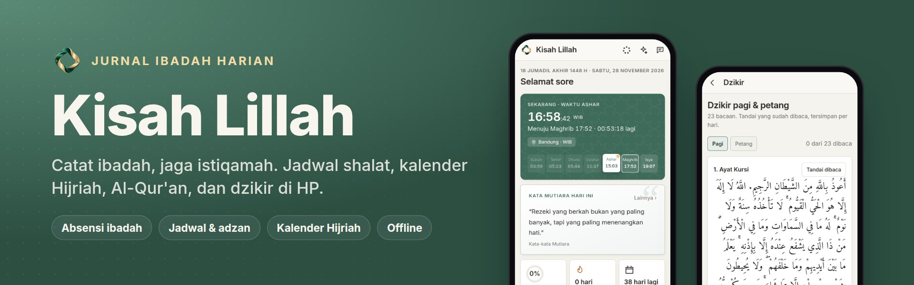
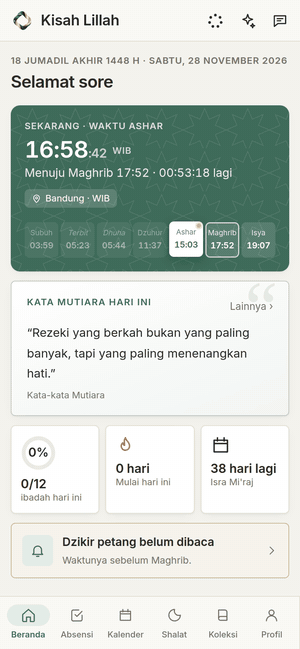
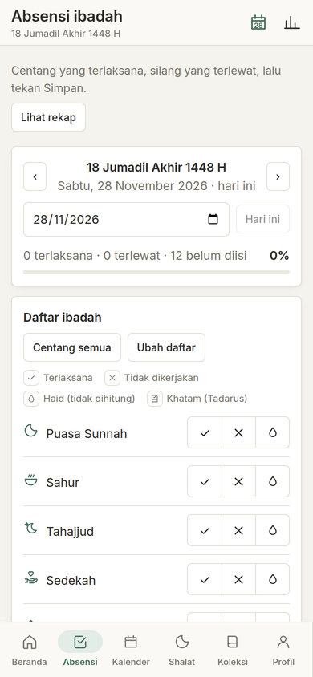
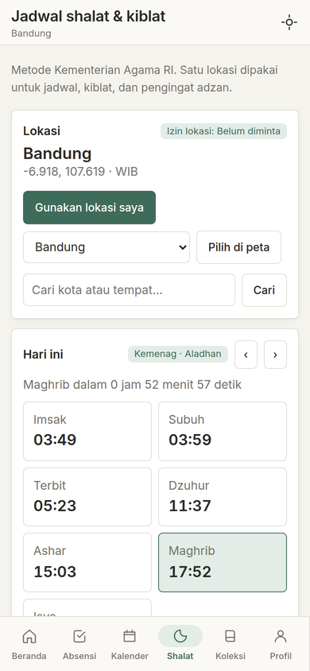
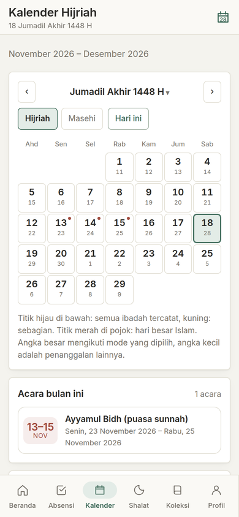
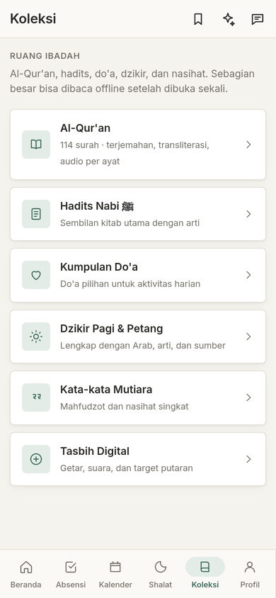
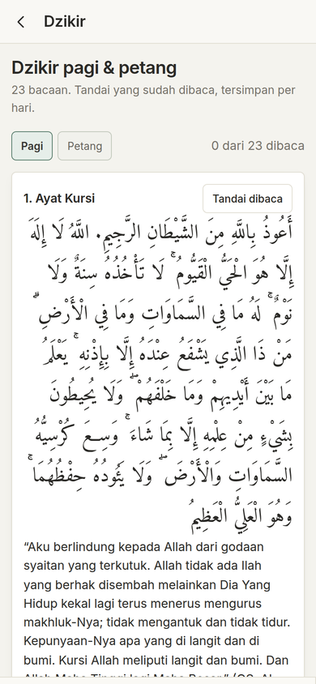

  

  
  

  
  
  
  
  

**Kisah Lillah** adalah jurnal ibadah harian: centang ibadah yang sudah dikerjakan, lihat rekap dan istiqamahmu, lalu buka jadwal shalat, kalender Hijriah, Al-Qur'an, hadits, doa, dan dzikir dari satu aplikasi. Sebagian besar isi tetap bisa dibaca tanpa internet setelah dibuka sekali.

> Repo ini hanya berisi file unduhan aplikasi Android (APK). Kode sumber Kisah Lillah bersifat privat.

## Sekilas

<table>
  <tr>
    <td align="center"> Beranda</td>
    <td align="center"> Absensi ibadah</td>
    <td align="center"> Jadwal shalat & kiblat</td>
  </tr>
  <tr>
    <td align="center"> Kalender Hijriah</td>
    <td align="center"> Ruang ibadah</td>
    <td align="center"> Dzikir pagi & petang</td>
  </tr>
</table>

## Fitur utama

**Jurnal ibadah**
- **Absensi ibadah** harian: tandai terlaksana, terlewat, atau haid (tidak dihitung), dengan daftar ibadah yang bisa diubah
- **Rekap** per 7 hari atau per bulan, plus target istiqamah (3 hari, 14 hari, 100 hari)
- Beranda dengan waktu shalat berikutnya, kata mutiara harian, hitung mundur hari besar, dan pengingat dzikir pagi/petang

**Waktu ibadah**
- **Jadwal shalat & kiblat** dengan metode Kementerian Agama RI; lokasi dari GPS, daftar kota, pencarian, atau pilih di peta
- **Pengingat adzan** lewat notifikasi
- **Kalender Hijriah** dan Masehi, lengkap dengan hari besar dan puasa sunnah tiap bulan

**Ruang ibadah**
- **Al-Qur'an** 114 surah dengan terjemahan Indonesia, transliterasi, dan audio per ayat; per surah atau juz, bookmark, dan terakhir baca
- **Hadits Nabi** dari sembilan kitab utama dengan arti
- **Kumpulan do'a** harian, **dzikir pagi & petang** (Arab, arti, dan sumber, bisa ditandai sudah dibaca)
- **Kata-kata mutiara** (mahfudzot dan nasihat singkat)
- **Tasbih digital** dengan getar, suara, dan target putaran, juga tasbih melayang

**Akun & lainnya**
- Masuk dengan Google atau email agar data tersimpan di cloud dan sama di ponsel dan desktop (tanpa akun, data tersimpan di perangkat)
- Rekap ibadah bisa dikirim ke nomor WhatsApp
- **Kili AI**, asisten untuk bertanya seputar ibadah, doa, atau cara memakai aplikasi
- **Pesan** antar pengguna, terenkripsi ujung-ke-ujung di perangkat

## Unduh & pasang

1. Buka halaman [Releases terbaru](https://github.com/ky-Mind/kisahlillah/releases/latest).
2. Di bagian **Assets**, ketuk file `kisah-lillah-<versi>.apk` untuk mengunduh.
3. Buka file yang sudah terunduh. Bila Android meminta, izinkan *instal aplikasi dari sumber tidak dikenal* untuk browser atau pengelola file yang dipakai.
4. Ketuk **Instal**, lalu buka Kisah Lillah. Izin lokasi dan notifikasi adzan boleh dilewati dan diatur kapan saja di Profil.

Tidak mau memasang APK? Buka <https://kisahlillah.web.id> di browser HP, lalu pilih *Tambahkan ke layar utama*.

## Pembaruan

Versi baru selalu diterbitkan di [Releases](https://github.com/ky-Mind/kisahlillah/releases). Cukup pasang APK baru di atas versi lama.

Repo ini dulu bernama **Agenda-Hijriah**. Aplikasi versi lama (5.4.2 ke bawah) masih memeriksa pembaruan lewat alamat lama itu, dan GitHub otomatis mengalihkannya ke repo ini, jadi pembaruan tetap sampai.

## Tautan

- Situs: <https://kisahlillah.web.id>
- Kebijakan privasi: <https://kisahlillah.web.id/privasi.html>
- Kontak: kontak@kisahlillah.web.id

---

Dibuat oleh <a href="https://github.com/ky-Mind">ky-Mind</a> · <a href="https://kymind.web.id">kymind.web.id</a>

